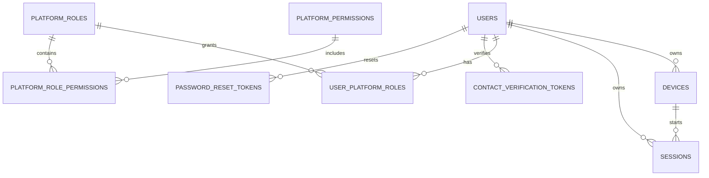
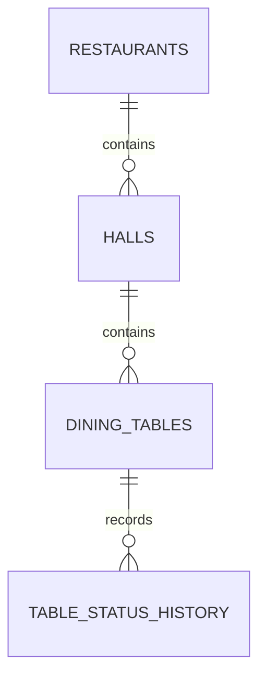
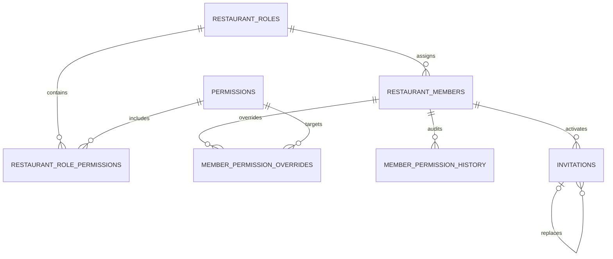
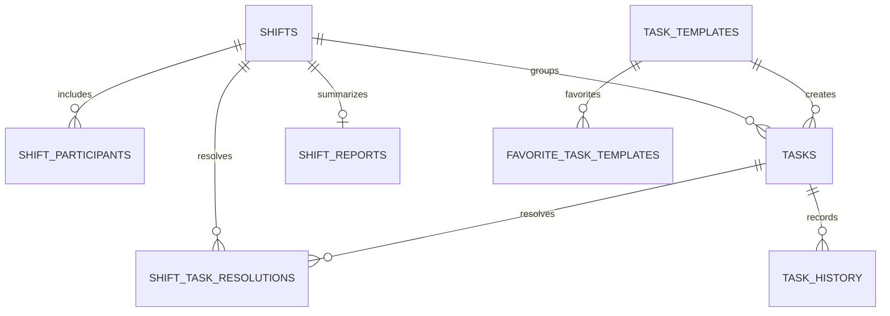
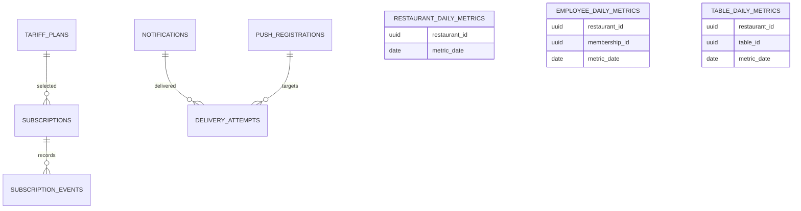

# ERD микросервисных баз

Диаграммы разделены по физическим базам. Пунктирные логические ссылки между диаграммами не являются
внешними ключами PostgreSQL.

## Identity

## Restaurant

`RESTAURANTS.director_user_id` ссылается логически на identity, а
`TABLE_STATUS_HISTORY.changed_by_membership_id` — на workforce.

## Workforce

`restaurant_id` и `user_id` — логические ссылки на restaurant и identity.

## Operations

Все `membership_id` и `restaurant_id` являются внешними UUID без FK.

## Billing, Notification, Audit, Reporting

Audit-таблицы append-only и не имеют доменных FK: они должны сохранять историю даже после
архивирования исходной сущности.

## Интеграционные таблицы

`identity`, `restaurant`, `workforce`, `operations`, `billing` и `notification` имеют собственную
`outbox_events`. Все потребители имеют `inbox_messages`. Эти таблицы намеренно дублируются в базах:
они являются частью надёжности каждого сервиса, а не общей инфраструктурной базой.
