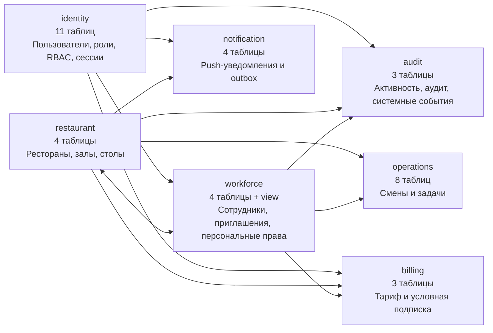
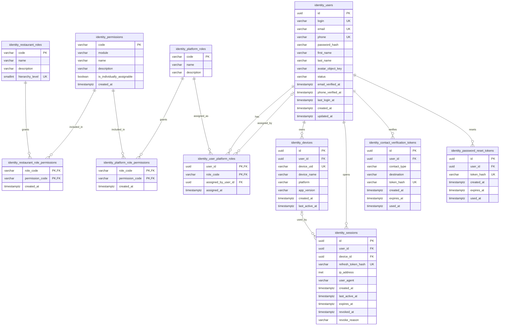
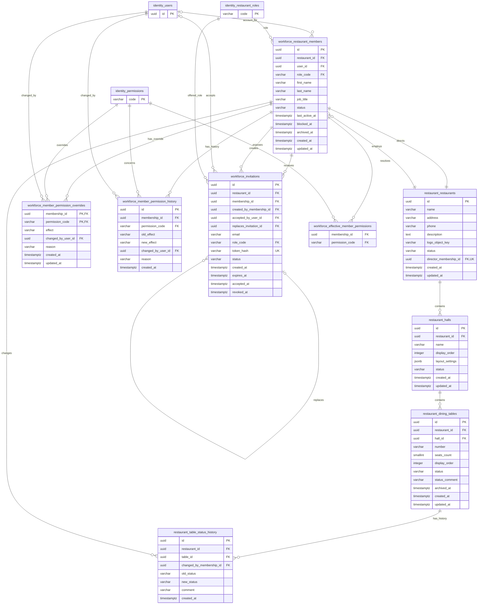
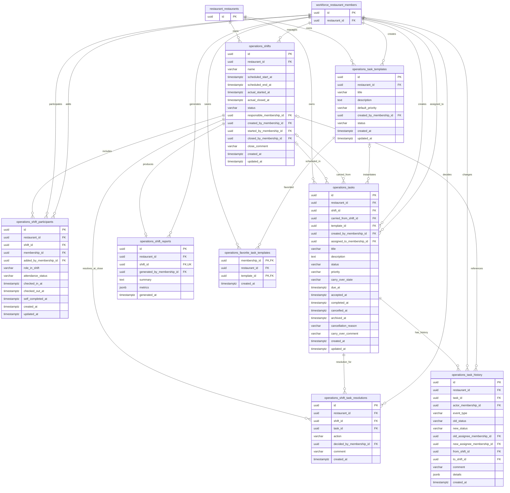
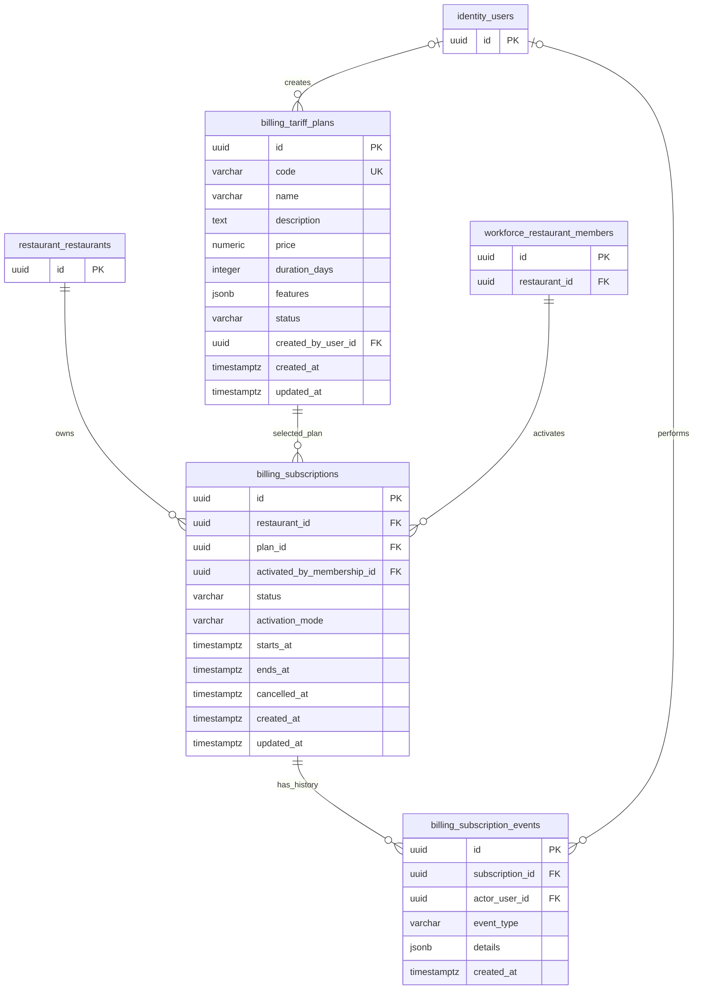
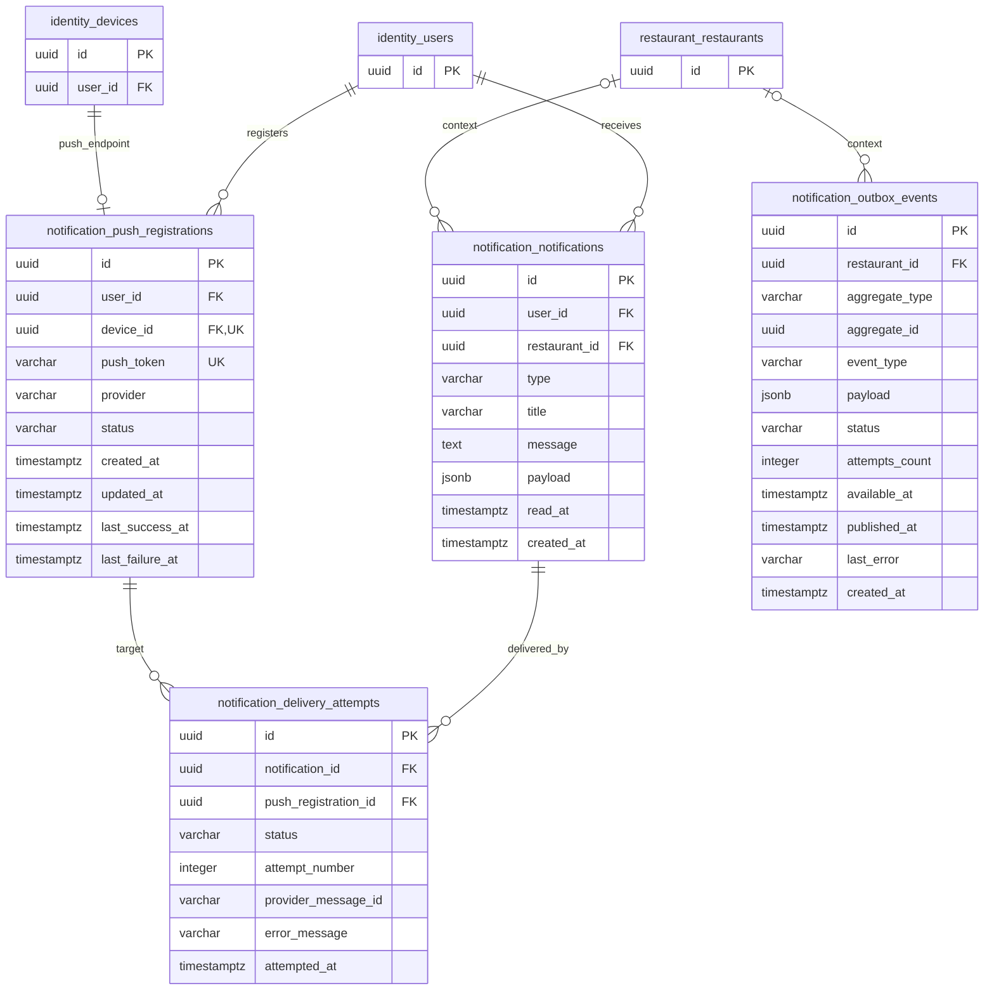
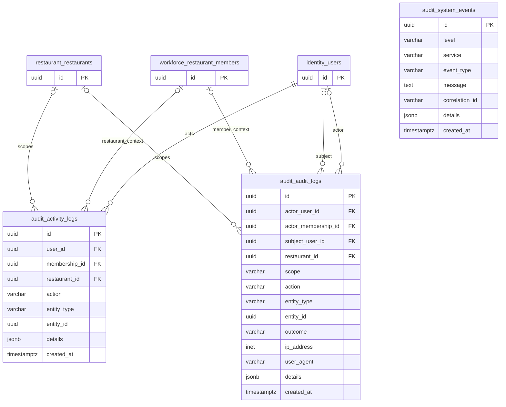

# ERD модульной базы данных REST

Диаграмма построена по фактическим Flyway-миграциям `V1`–`V9`. Она описывает 37 таблиц,
одно вычисляемое представление и связи между семью PostgreSQL-схемами.

## PNG-версии

- [Полная ERD со всеми модулями](erd/png/restaurant-database-full-erd.png)
- [Карта модулей](erd/png/00-modules-overview.png)
- [Identity и RBAC](erd/png/01-identity-rbac.png)
- [Restaurant и Workforce](erd/png/02-restaurant-workforce.png)
- [Operations](erd/png/03-operations.png)
- [Billing](erd/png/04-billing.png)
- [Notification](erd/png/05-notification.png)
- [Audit](erd/png/06-audit.png)

## Карта модулей

Циклическая связь `restaurant ↔ workforce` намеренная: ресторан содержит ссылку на своего
единственного директора, а запись директора принадлежит этому же ресторану. Оба внешних ключа
отложенные (`DEFERRABLE INITIALLY DEFERRED`), поэтому пара создаётся в одной транзакции.

## Identity и RBAC

Ресторанные роли: `EMPLOYEE`, `MANAGER`, `DIRECTOR`. Глобальная платформенная роль:
`SYSTEM_ADMIN`. Права лежат в данных, а не зашиты в коде.

## Restaurant и Workforce

`workforce.effective_member_permissions` — вычисляемое представление, а не отдельная таблица.
Оно объединяет права роли с индивидуальными `GRANT`/`DENY`.

Состояния столов: `READY`, `NEEDS_CLEANING`, `NEEDS_SERVING`, `PROBLEM`. Цветов в базе нет;
интерфейс получает только состояние и сам выбирает оформление.

## Operations

У ресторана может быть только одна активная смена. Просроченность задачи вычисляется из
`due_at` и `status`, отдельного состояния `OVERDUE` нет. Перенос хранится в
`carry_over_state`, а решение при закрытии смены — в `shift_task_resolutions`.

## Billing

Платёжных транзакций, возвратов и споров нет. Кнопка-заглушка активирует бесплатный
`MONTHLY_PLACEHOLDER` на 30 дней; у ресторана может быть только одна активная подписка.

## Notification

Внутренних диалогов и сообщений между пользователями нет. `message` — только текст системного
уведомления, а `outbox_events` — техническая очередь событий для RabbitMQ/WebSocket.

## Audit

`audit_logs`, `activity_logs`, `system_events`, а также истории задач, статусов столов и
индивидуальных прав — append-only: изменение и удаление блокируются триггерами.

## Важные обозначения и ограничения

- `PK` — первичный ключ, `FK` — внешний ключ, `UK` — уникальное значение/ограничение.
- В составных внешних ключах вместе с идентификатором передаётся `restaurant_id`, чтобы нельзя
  было связать сущности разных ресторанов.
- Ресторан имеет строго одного неархивного директора.
- Индивидуальные права хранятся для конкретного `restaurant_members.id`, а не глобально для
  пользователя.
- Технические индексы, `CHECK`-ограничения и триггеры перечислены в миграциях; на ERD показаны
  сущности, поля, уникальность и внешние связи.

Исходные миграции: [`backend/src/main/resources/db/migration`](../src/main/resources/db/migration).
